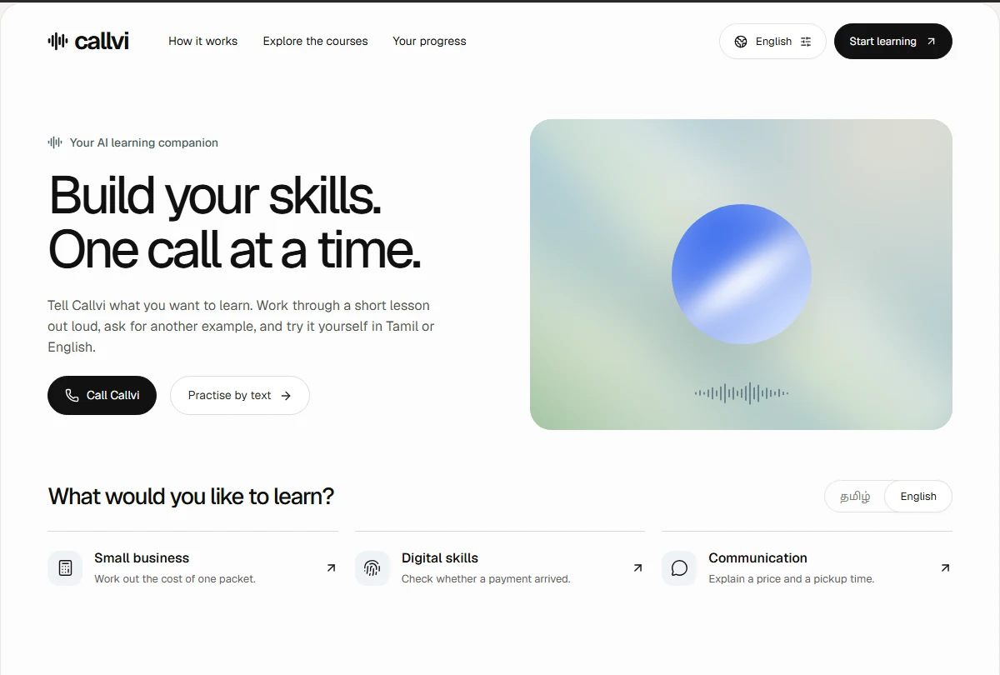

# Callvi

[](https://shaangs.github.io/callvi-prompt-war/)

**[Try the rehearsal in English](https://shaangs.github.io/callvi-prompt-war/) · [தமிழில் முயலுங்கள்](https://shaangs.github.io/callvi-prompt-war/?lang=ta) · [Watch the 25-second demo](https://shaangs.github.io/callvi-prompt-war/walkthrough.mp4)**

A customer wants her trousers shortened for ₹40 by tomorrow. You charge ₹50 and need two days. What would you say when she calls?

Callvi gives women running small businesses a place to practise that conversation in Tamil or English. The AI voice agent plays the customer. A bilingual lesson rubric checks the offer and tells the learner which detail the customer still needs. She can try again in her own words. **Prompt War vertical · AI for Education.**

## Try it in a minute

1. Open the rehearsal above and press **Hear the customer**. The prompt is also written on screen.
2. Answer **“I charge fifty rupees.”** Press **Check my reply**. Callvi recognises the fee and asks when the trousers will be ready.
3. Add **“I can have them ready in two days.”** Submit the complete offer. Compare both attempts, or try giving only the pickup time. Switch to Tamil to hear the same customer's request.

The public rehearsal plays prerecorded customer speech. Written replies are checked in your tab with the same assessment function used by the voice agent. Refreshing clears the exercise. The prices and turnaround time belong to this fictional order.

## Where the phone fits

| Experience | What the learner does | What it needs |
| --- | --- | --- |
| Browser rehearsal | Listen, type a reply, retry and compare attempts | The public link above |
| Live AI conversation | Speak to the customer, interrupt, ask for another explanation and retry | Configured Sarvam or ElevenLabs browser agent and microphone |
| Inbound phone | Dial from a handset, practise by speech and resume a consented checkpoint on a later call | Deployed Sarvam phone agent, inbound number and verified redial |

The intended learner can use a basic phone. The inbound integration has a two-call regression covering consent, identity and resume. A physical handset test and public Cloud Run URL are still pending. [Phone flow](docs/CALL_FIRST_PRODUCT.md) · [Pitch and deployment](docs/PROMPT_WAR.md)

## How Callvi makes a decision

The voice provider handles dialogue and speech. The Next.js server authenticates tool callbacks, loads the current lesson and evaluates the reply against its criteria. The tailoring lesson checks fee and pickup independently. Its Tamil and English phrase lists accept common variants. An unfamiliar substantive answer can receive an ungraded result. This exercise checks the details of an offer; it does not score accent or fluency.

PostgreSQL holds consented checkpoints. Repeated provider callbacks use idempotency checks. The browser rehearsal needs neither a database nor a provider key. [Lesson and rubric](src/content/courses/customer-call.ts) · [Assessment function](src/server/services/assessment/assessment-service.ts) · [Privacy and retention](docs/PRIVACY_AND_RETENTION.md)

## Run locally

Use Node.js 24. The development server starts an embedded PostgreSQL database on first use.

```bash
npm ci
npm run dev
```

Open [localhost:3000](http://localhost:3000) and choose **Practise by text**. For live voice, configure a provider and its authenticated callbacks. [Setup guide](docs/SETUP.md) · [Environment variables](.env.example)

| Verify or build | Command |
| --- | --- |
| Lint, type-check, run tests and build Next.js | `npm run check` |
| Run unit, integration and agent-scenario tests | `npm test` |
| Run desktop and mobile journeys | `npx playwright install chromium` then `npm run test:e2e` |
| Build the standalone judge rehearsal | `npm run build:rehearsal` |

The app uses TypeScript, React, Next.js, Zod and PostgreSQL. Sarvam and ElevenLabs provide live voice integrations. PGlite, Vitest and Playwright support local testing. GitHub Actions verifies and publishes the standalone rehearsal. [Verification and build workflow](.github/workflows/rehearsal.yml)

## Project history

The Callvi voice companion, three courses and provider adapters predate Prompt War. For this edition we built the tailoring scenario and bilingual rubric, an audible browser rehearsal with per-attempt feedback, a two-call regression, Cloud Run packaging and a public interactive demo. The curriculum is team-authored. [Project description and pitch](docs/PROMPT_WAR.md) · [Media credits](docs/MEDIA.md)
